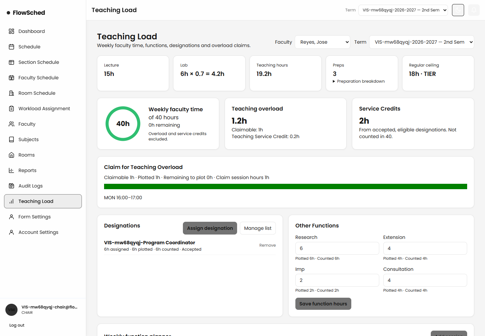
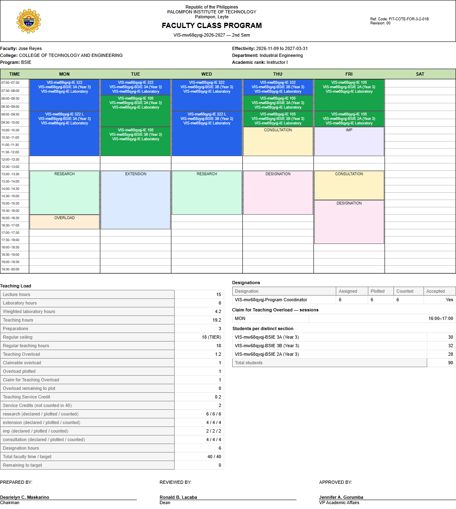
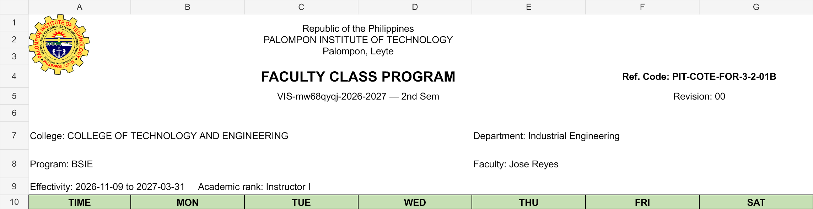

# FlowSched teaching load implementation report

Completed on 7 November 2026. All seven phases are implemented and committed locally; no commits were pushed. Existing teaching-load, designation, scheduling, conflict and authorization code was extended. Unrelated working-tree changes were preserved.

## Phase delivery and verification

| Phase | Delivered | Verification at phase gate | Local commit |
|---|---|---|---|
| 1. Engine and settings | Computed-on-read rules, shared rounding, component preparations, configurable ceilings/coefficient/target, overload split, session-based counting, singleton settings | API 173, frontend 192; builds passed | `20ba7eb` |
| 2. Data and APIs | SQLite migrations and partial indexes, declarations/sessions/students/effectivity, role reconciliation, designation extensions, form/logo/signatory settings, bidirectional session conflicts | API 183, frontend 192; builds passed | `35a2881` |
| 3. Teaching Load and Dashboard | Faculty self scope and management picker, summary/ring, overload claims, separate credits, declaration/student/designation forms, movable function planner, computed Dashboard load | API 183, frontend 198; builds passed | `a8dcb5f` |
| 4. Scoped scheduling | Existing drag grid extended to Room/Faculty/Section, selection prompts, room selector for new scoped blocks, duration/color/override behavior retained, room query parameter | API 184; frontend 200 across full and targeted runs, including 44 schedule tests; builds passed | `b328aa8` |
| 5. Print and Form Settings | Three shared print models and forms, A4 landscape print CSS, header/logos/references, effectivity, faculty summary, local signature choices, Chair settings | API 185; frontend 202 across full and targeted runs; builds passed | `248333b` |
| 6. Excel | Authenticated server-side exceljs exports, shared headers/signatures, colored merged schedule blocks, faculty Teaching Load input/formula sheet, existing export buttons connected | API 187; frontend 203 across full and targeted runs; builds passed | `773feb0` |
| 7. Documentation and final QA | Rules/schema/UI docs, missing-only defaults seed, final minimum/validation/signatory/pagination checks, overlapping print lanes, real Excel recalculation and screenshots | Full API 187/187 and frontend 207/207; API, frontend and shared builds passed | Final documentation and verification commit |

Final commands: `npm test` and `npm run build` from the repository root. The shared package has no test suite. Existing non-blocking router/dependency deprecation and large-bundle warnings remain.

## Calculation and permission evidence

- F1: lecture 15, laboratory 6, weighted laboratory 4.2, teaching 19.2, preparations 3, ceiling 18, overload 1.2, claimable 1, Teaching Service Credit 0.2.
- F2/F3 and tier boundaries, zero preparations, below-ceiling teaching, extrapolation and floating-point rounding are covered by the engine tests.
- F4: regular teaching 18 + Research 6 + Extension 4 + IMP 2 + Consultation 4 + Designation 6 = 40. Overload and Service Credits are excluded.
- Short designation sessions count zero hours and zero Service Credits. Overload minimum, whole-hour duration and claim caps are validated. Student totals deduplicate sections.
- API tests cover Faculty 403s, management scope, duplicate records, soft-delete/recreation, invalid signatures, teaching/session overlaps, the existing structured teaching override, and all three export scopes.
- Microsoft Excel opened the generated faculty workbook and recalculated its formulas. Removing laboratory inputs changed preparations from 3 to 2, ceiling from 18 to 21 and total time from 40 to 37. Restoring laboratories and shortening designation sessions to half an hour removed designation hours and credits, producing 34 total hours. No formula errors were found.
- The actual browser-generated PDF was rendered and visually reviewed: two clean A4 landscape pages, with the timetable and detailed summary/signatures readable.

## Screenshots

Screenshots use temporary, uniquely prefixed F1/F4 data. The example dates are fixture dates, not approved term dates. All fixture rows were removed after capture.

### Teaching Load page

### Faculty Class Program in print media

### Generated Excel header

## Deviations and configuration still needed

- The latest specification's A4 landscape forms and configurable preparation ceilings supersede the earlier template's paper size and fixed teaching-hours formula. This is an implementation of the requested current form system, not a claim of pixel-identical reproduction of the earlier `.xls`.
- The supplied school logo and faculty reference `PIT-COTE-FOR-3-2-01B` are used. A TUV NORD image and approved Student Class Program/Classroom Utilization reference codes were not available. Those fields remain configurable and empty. Real term effectivity dates and the Chairman's final designation list also remain to be entered.
- The sample faculty print spans two pages to keep its schedule and full load tables readable. The print-media screenshot shows the complete content, while the actual PDF was checked page by page.
- For approved overlapping teaching blocks, print uses separate lanes. Excel keeps all labels in the affected merged interval and uses the first block's color; one merged Excel cell cannot independently color multiple overlapping blocks.
- Baseline malformed Teaching Load draft/type issues were repaired so the repository could build. The original draft was preserved at `C:\Users\Asus\AppData\Local\Temp\flowsched-teaching-load-original-20261107-1816.tsx`.
- The deprecated `Faculty.max_units` column remains for compatibility. It no longer determines load status. Existing unrelated account, audit and theme changes were left outside these commits.

## All assumptions awaiting Chairman confirmation

1. The laboratory coefficient applies only to laboratory hours.
2. The weekly target counts regular teaching capped at its preparation ceiling; overload and both kinds of service credit are excluded.
3. `MIN_DECLARED_PLOTTED` is the counting rule: function/designation hours count up to the smaller of declared/assigned and valid plotted hours.
4. Overload is plotted and claimed only in whole-hour sessions; its fractional remainder is Teaching Service Credit.
5. Student counts belong to faculty + section + term, and a section handled for multiple subjects is totaled once.
6. Other functions use the same minimum-session validity rule as designations.
7. Seven or more preparations extrapolate the highest configured tier and display a warning until the real ceiling is confirmed.

## Setup and hygiene

The SQLite migrations and checks were applied locally. `npm run seed:program --workspace api` adds missing program defaults and the development academic-admin account without resetting edited settings or changing real assignments/subjects/terms. The normal seed also uses this helper.

API fixtures use unique prefixes and cleanup hooks. Final checks found zero remaining `FSP-` or `VIS-` fixture faculty and no corresponding fixture users, terms, sessions, assignments, sections, subjects, rooms or designations. Scratch scripts, task logs, temporary PDF/workbook renders and the temporary runtime junction were removed. Only the three requested screenshot artifacts are retained in the verification output folder.

See [calculation rules and API details](teaching-load-rules.md), [schema](4-database.md), [UI/UX](5-ui%20ux.md), and [Excel export details](faculty-excel-export.md).
